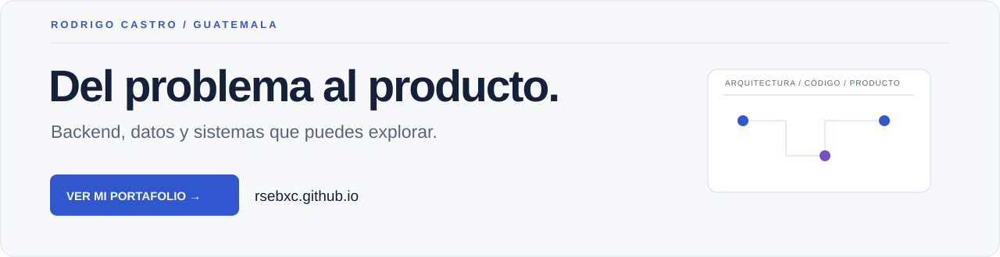
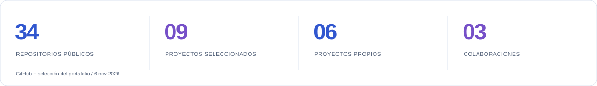
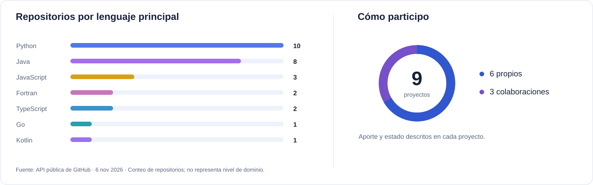
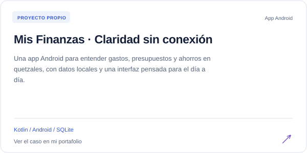
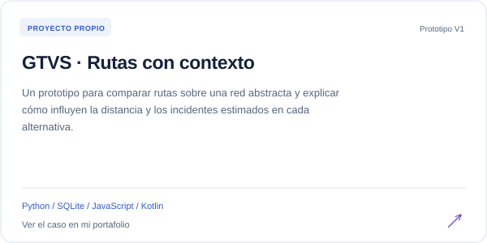
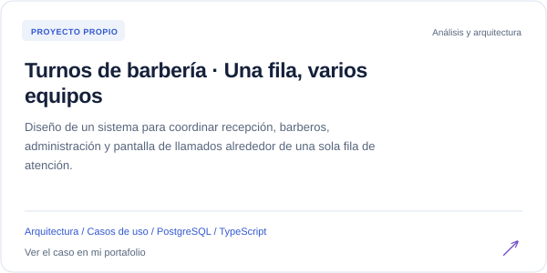
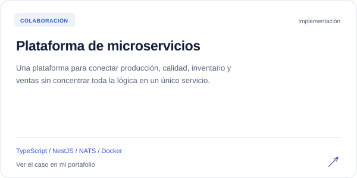
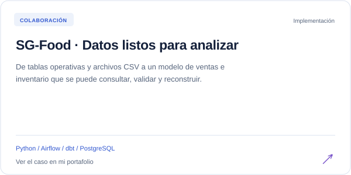
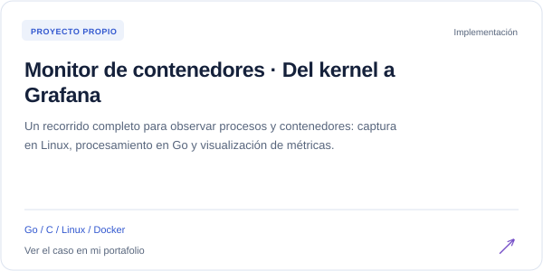

<a href="https://rsebxc.github.io/">
<picture>
  <source media="(prefers-color-scheme: dark)" srcset="assets/profile-banner-dark.svg">
  
</picture>
</a>

# Rodrigo Sebastián Castro Aguilar

**Desarrollador backend y soporte de bases de datos · Guatemala**

## [Mira mi portafolio → rsebxc.github.io](https://rsebxc.github.io/)

En mi portafolio encontrarás los proyectos, su estado, las decisiones técnicas y mi contribución en cada uno. También puedes [descargar mi CV](https://rsebxc.github.io/CV_Rodrigo_Castro_Aguilar.pdf).

[Portafolio](https://rsebxc.github.io/) · [LinkedIn](https://www.linkedin.com/in/rodrigo-castro-95233632b) · [Correo](mailto:RS.CASTRO0417@gmail.com)

Me gusta convertir un problema en un sistema que se pueda explicar, probar y mejorar. Trabajo con aplicaciones Java, servicios backend y bases de datos Oracle; también construyo productos Android, flujos de datos e infraestructura cloud.

En mis proyectos propios defino la idea, el contexto, los casos de uso y la arquitectura. Me apoyo en herramientas de IA durante la implementación y mantengo la responsabilidad de las decisiones y la revisión.

## Mi trabajo, en cifras

<picture>
  <source media="(prefers-color-scheme: dark)" srcset="assets/metrics-dark.svg">
  
</picture>

<picture>
  <source media="(prefers-color-scheme: dark)" srcset="assets/code-overview-dark.svg">
  
</picture>

[Fuente: repositorios públicos de GitHub](https://github.com/RSebXC?tab=repositories), revisados el **6 de noviembre de 2026**. Las gráficas describen código publicado y autoría de esta selección; no son porcentajes de dominio ni métricas de usuarios.

## Proyectos para explorar

Cada tarjeta abre el caso en mi portafolio. El enlace inferior lleva directamente al repositorio.

<table>
<tr><td width="50%"><a href="https://rsebxc.github.io/#finanzas"><picture>
  <source media="(prefers-color-scheme: dark)" srcset="assets/projects/finanzas-dark.svg">
  
</picture></a><a href="https://github.com/RSebXC/App-ControlFinanzas">Ver código y documentación ↗</a></td><td width="50%"><a href="https://rsebxc.github.io/#gtvs"><picture>
  <source media="(prefers-color-scheme: dark)" srcset="assets/projects/gtvs-dark.svg">
  
</picture></a><a href="https://github.com/RSebXC/GTVS-2027">Ver código y documentación ↗</a></td></tr>
<tr><td width="50%"><a href="https://rsebxc.github.io/#barberia"><picture>
  <source media="(prefers-color-scheme: dark)" srcset="assets/projects/barberia-dark.svg">
  
</picture></a><a href="https://github.com/RSebXC/Servicio-Barberia">Ver código y documentación ↗</a></td><td width="50%"><a href="https://rsebxc.github.io/#microservicios"><picture>
  <source media="(prefers-color-scheme: dark)" srcset="assets/projects/microservicios-dark.svg">
  
</picture></a><a href="https://github.com/RSebXC/Proyecto-SA-B-3">Ver código y documentación ↗</a></td></tr>
<tr><td width="50%"><a href="https://rsebxc.github.io/#sg-food"><picture>
  <source media="(prefers-color-scheme: dark)" srcset="assets/projects/sg-food-dark.svg">
  
</picture></a><a href="https://github.com/RSebXC/SS22S2026_G26/tree/main/Proyecto1">Ver código y documentación ↗</a></td><td width="50%"><a href="https://rsebxc.github.io/#monitoreo"><picture>
  <source media="(prefers-color-scheme: dark)" srcset="assets/projects/monitoreo-dark.svg">
  
</picture></a><a href="https://github.com/RSebXC/202204496_LAB_SO1_2S2025/tree/main/Proyecto2">Ver código y documentación ↗</a></td></tr>
</table>

**También he construido:**

- **[Discos virtuales · El almacenamiento por dentro](https://rsebxc.github.io/#discos)** — Diseño e implementación completa. [Repositorio](https://github.com/RSebXC/MIA_2S_P1_202204496).
- **[CloudCinema · Arquitectura en AWS](https://rsebxc.github.io/#cloudcinema)** — Arquitectura e infraestructura cloud. [Repositorio](https://github.com/RSebXC/SEMINARIO1_A_1S2026_G5/tree/main/Practica_1).
- **[OakLand-js · Del lenguaje a RISC-V](https://rsebxc.github.io/#compiladores)** — Diseño e implementación completa. [Repositorio](https://github.com/RSebXC/OLC2_Proyecto1_202204496).

Los proyectos se presentan como **propios o colaboraciones**. Mis Finanzas tiene app Android; GTVS es un prototipo con datos sintéticos y no garantiza seguridad de una ruta; Barbería está en análisis y arquitectura, con implementación pendiente. [Explorar los nueve casos →](https://rsebxc.github.io/#proyectos)

## Stack técnico

           

| Área | Tecnologías |
| --- | --- |
| Lenguajes | Java · Python · TypeScript · JavaScript · Go · Kotlin · SQL · PL/SQL · C/C++ |
| Backend | Spring Boot · NestJS · FastAPI · Node.js/Express · APIs REST · Microservicios |
| Datos | Oracle · PostgreSQL · MySQL · MongoDB · Neo4j · SQLite · Airflow · dbt · BigQuery |
| Cloud y entrega | AWS: EC2, S3, RDS, IAM · Google Cloud · Docker · Kubernetes · CI/CD |
| Producto e integración | Android · React · Angular · PrimeFaces · Git · Grafana · Power BI |

## Experiencia y formación

- **SAT · Servicios técnicos:** desarrollo y mantenimiento de aplicaciones Java, soporte de sistemas institucionales y trabajo con SQL/PLSQL y Oracle.
- **Prácticas de telemedicina en la USAC:** servicios NestJS, PostgreSQL, Docker e integración con Angular.
- **Ingeniería en Ciencias y Sistemas — USAC:** pensum cerrado, pendiente de graduación.
- **Samsung Innovation Campus:** Proyecto de Inteligencia Artificial con Python, 200 horas · 2025.
- Español nativo e inglés básico.

## Conversemos

¿Tienes una oportunidad en backend, datos o desarrollo de producto? [Conoce mi trabajo](https://rsebxc.github.io/) y escríbeme a **[RS.CASTRO0417@gmail.com](mailto:RS.CASTRO0417@gmail.com)** o por **[LinkedIn](https://www.linkedin.com/in/rodrigo-castro-95233632b)**.

Iconos de tecnologías: Devicon, licencia MIT incluida en assets/tech/LICENSE.txt. Las métricas son una captura fechada; no dependen de servicios externos de estadísticas.
